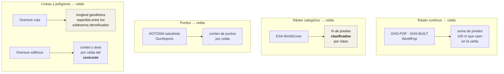
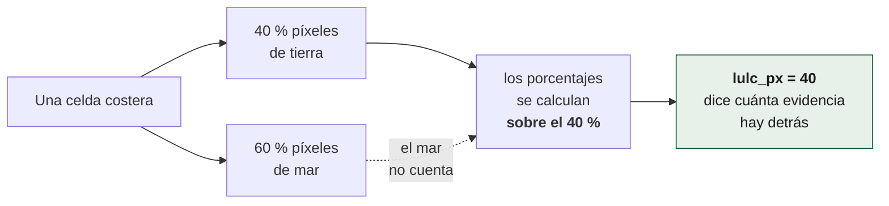
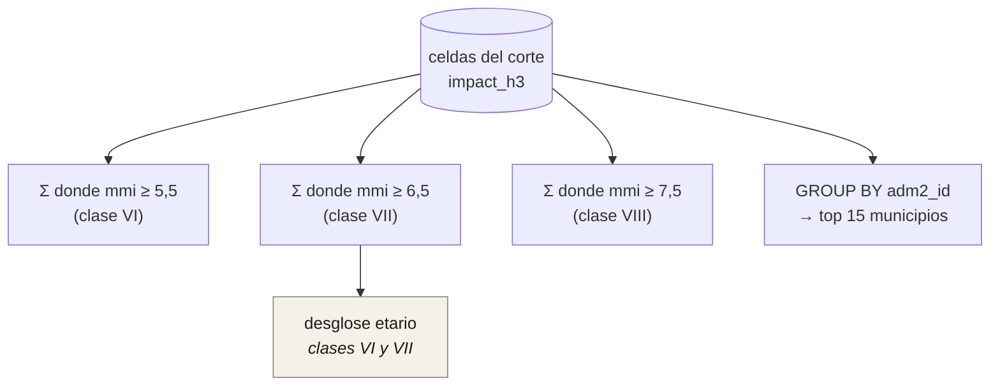

# Agregaciones

Cómo se convierte cada fuente en una columna de la celda. Es la parte del
sistema donde un error no se ve: una agregación mal hecha produce una cifra
perfectamente plausible.

## Las cuatro familias



## Las decisiones que no son obvias

### Vías: recortadas, no asignadas al centroide

Una carretera de 40 km cruza muchas celdas. Asignarla entera a la celda de su
centroide daría 40 km en una celda y 0 en las vecinas.

Lo que se hace (y este documento lo describía mal) es **densificar y repartir**:
la longitud se mide entera con `ST_Length_Spheroid`, que es geodésica sobre el
elipsoide (no hay ninguna reproyección equiárea en el repositorio, y una
equiárea sería además la clase equivocada para medir longitud), la vía se parte
en *n* subtramos de ~200 m, y cada subtramo aporta `km/n` a la celda de **su
punto medio**.

El punto medio, no el extremo: `ST_LineInterpolatePoints(geom, 1/n, true)`
devuelve las fracciones 1/n … 1,0, o sea el final de cada subtramo y nunca el
principio, con un sesgo sistemático de medio subtramo siempre en la dirección
del trazado. Se piden 2n puntos en medios pasos y se conservan los impares.
`test_vector_h3.py` lo comprueba, y comprueba también que `sum(km/n)` sigue
siendo `km`.

> Esta cifra estuvo mal en el README por un factor de seis, porque se copió a
> mano y el activo se reconstruyó después. Desde el 13-sep-2026 el README no
> publica cifras: las de cada evento están en su `report.json`.

### Edificaciones: por centroide, y se asume

Un edificio pertenece a la celda de su centroide, aunque cruce el borde. A
0,74 km² por celda, el error es despreciable frente al de la propia cobertura
de OSM.

### Cobertura del suelo: el porcentaje es sobre lo clasificado



En la costa media celda es mar, y el mar no es una clase de cobertura. Los
porcentajes van sobre los píxeles **clasificados**, y `lulc_px` publica cuántos
eran: *"una celda con nueve píxeles y otra con ciento cuarenta no merecen la
misma confianza"*.

### Estructura etaria: la banda central es el residuo

```
pop_0_14   ← conteo de WorldPop
pop_65p    ← conteo de WorldPop
pop_15_64  ← pop_total − pop_0_14 − pop_65p
```

`pop_total` viene de GHS-POP y los extremos de WorldPop: son dos modelos
distintos. La banda central, al ser el residuo, **absorbe toda la diferencia
entre ambos**. Es una decisión declarada, no un descuido, y la banda de
discrepancia publicada la acota.

### Población: suma dasimétrica

No se reparte población por área: se suman los píxeles de 100 m de GHS-POP,
que ya está desagregado dasimétricamente usando volumen construido. La celda
hereda la desagregación de la fuente en vez de inventar la suya.

## De la celda al reporte



**Las bandas son acumulativas**: "personas en MMI≥VII" incluye a las de la
clase VIII.

### Clases del USGS, no decimales literales (`report/2.0`, 21-nov-2026)

Hasta la versión 1.0 del reporte las bandas eran literales: `pop_mmi6p` contaba
las celdas con MMI ≥ 6,0. El USGS —PAGER, la Mercalli abreviada— nombra la
intensidad en números romanos y redondea: la clase VI empieza en **5,5**. Con
el corte literal, el M6,7 de Carhuamayo (`pt26325050`, 108 km de profundidad),
cuyo ShakeMap llega a 5,7, salía con cero personas mientras PAGER contaba 5.398
en intensidad VI; quince de treinta y nueve reportes publicados estaban en cero.

Desde la 2.0 cada banda es una clase con el corte del USGS: VI ≥ 5,5, VII ≥ 6,5,
VIII ≥ 7,5 (`UMBRAL_CLASE` en `pipelines/common/constants.py`). Los nombres de
columna se conservan —`pop_mmi6p` es «clase VI o más»— y el cambio lo anuncian
la versión del esquema y una línea del changelog de cada reporte reemitido.

**Sin nadie en la clase VI no hay reporte.** El evento pasa al estado
`sin_alcance`, se retira lo que tuviera publicado y aparece en
`site/sin_alcance.json`, que el visor pinta como «sismo visto, sin reporte» con
la intensidad alcanzada. No es terminal: un ShakeMap nuevo lo vuelve a medir.

### En qué banda se publica cada cosa, y por qué

Población en las clases **VI, VII y VIII o más**. Equipamiento (edificaciones, superficie
construida, salud, educación, vías) y desglose etario en las clases **VI y VII o más**
(sección «Bandas de intensidad publicadas» de `pipelines/common/constants.py`:
no son una constante, van en el nombre de cada columna, `*_mmi6p` y `*_mmi7p`).

Hasta el 3-sep-2026 el equipamiento se agregaba **solo** en MMI ≥ 7, y el
desglose etario también, con esta justificación escrita: *"más abajo la
incertidumbre del modelo etario sería mayor que la señal"*. **Esa razón no era
una razón**: la incertidumbre etaria viene de mezclar GHS-POP con WorldPop (lo
explica la sección de arriba) y es la misma en MMI 6 que en MMI 7. No es
función de la intensidad.

El efecto medido: **<!-- cifra:sin_mmi7_de_total -->veinticuatro de los treinta y nueve<!-- /cifra --> reportes no tienen población en
MMI ≥ 7**, así que publicaban "0 edificaciones, 0 hospitales, 0 escuelas, 0 km
de vía" con millones de personas dentro de MMI ≥ 6. `us7000jl3s`: 4,75 millones
de personas (3,1 de ellas en Guayaquil) y ni un solo hospital que nombrar.

Ninguna fuente autorizada sitúa el inicio del daño en MMI VII, y las que hay
convergen en VI: el USGS describe el grado VI como *"Damage slight"*; la tabla
de ShakeMap deja de decir *"None"* en MMI 5; la EMS-98 pone daño de grado 1 en
muchas construcciones de clase A ya en intensidad VI; GDACS deja de dar alerta
verde en MMI VI; y la OPS, para los sismos de Venezuela de 2026, reportó *"91
emergency hospitals located in areas affected by Intensity VI or above,
including 20 hospitals exposed to Intensity VII or higher"*. Las citas
completas están en la sección «Bandas de intensidad publicadas»
de `pipelines/common/constants.py`.

**Se añadió, no se movió.** Las columnas `*_mmi7p` conservan su significado
exacto y ninguna cifra publicada cambió de valor; las `*_mmi6p` son nuevas.
Lo que sí cambió es qué banda enseña el `report.md`: la que el evento alcanzó,
igual que ya hacía el ranking municipal.

### Ground Failure

**Se muestrea un punto por celda: el centroide.** No es una estadística areal.
El píxel del ráster es más pequeño que la celda —~230 m en el de deslizamiento
y ~460 m en Zhu, contra los ~0,74 km² de una celda r8—, así que el centroide
decide el valor de toda la celda con una fracción de su área. Un valor ≥
**0,10** cuenta como "alto" para el conteo de población expuesta, y ese umbral
se aplica al punto: la celda entra entera o no entra. A diferencia de
`mmi_max`, este muestreo **no es cota de nada** — puede quedarse corto o
pasarse. `NaN` significa fuera de la huella del modelo, no cero, no "sin
riesgo".

El ráster de licuefacción **no es probabilidad**: el producto de USGS deriva
por calibración una **cobertura areal** (la fracción de la celda que se espera
cubierta por manifestaciones de licuefacción), y el de deslizamiento sí es
probabilidad. Llamarlas igual afirma de una lo que solo vale para la otra, y el
`report.md` ya las distingue (`GF_UNIDAD`). El umbral 0,10 se aplica a las dos,
pero significa cosas distintas en cada una.

## La banda de discrepancia

El sistema publica dos poblaciones de la misma celda: `pop_total` (GHS-POP) y
`pop_alt_worldpop` (WorldPop). La segunda **nunca es la cifra principal**: su
único trabajo es acotar cuánto podrían diferir dos modelos razonables sobre el
mismo territorio, y esa banda se publica en `incertidumbre`.

Es el reconocimiento explícito de que la cifra tiene un intervalo, en un
producto cuyo riesgo principal es que alguien lea un número redondo como si
fuera un censo.

## <!-- cifra:sin_mmi7_de_total_titulo -->Veinticuatro de treinta y nueve<!-- /cifra --> eventos no llegan a MMI ≥ 7

Correr el catálogo regional entero enseñó algo que ninguna prueba sintética
habría encontrado: **<!-- cifra:sin_mmi7_de_total -->veinticuatro de los treinta y nueve<!-- /cifra --> eventos no alcanzan MMI ≥ 7
sobre población** (eran ocho de diecinueve cuando se midió por primera vez, y la
proporción se ha mantenido al crecer el catálogo). De ellos, **<!-- cifra:sin_mmi6 -->quince<!-- /cifra --> tampoco
alcanzan MMI ≥ 6**: para esos, la única cifra que dimensiona el evento es el
corte por radios alrededor del epicentro. Son los profundos y los de mar adentro, que en esta región son la
mitad. Tehuantepec 2017 (M8,2, 98 muertos) tiene su máximo sobre población
mexicana en **MMI 6,5**.

Hasta que se corrieron, el producto daba por supuesto que MMI ≥ 7 era *la*
banda y publicaba para esos once un titular de "0 personas" con una tabla de
municipios ordenada alfabéticamente. Ahora **se titula con la banda que el
evento alcanzó de verdad**.
